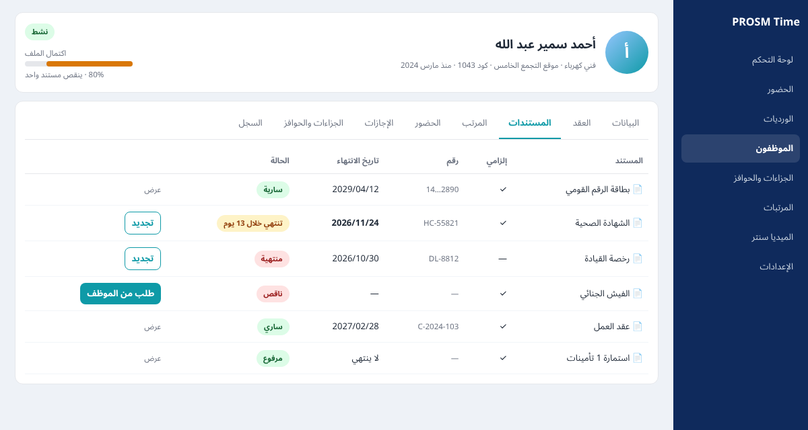
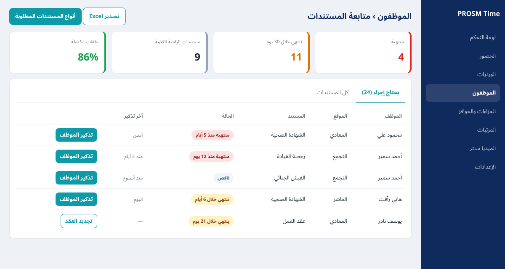
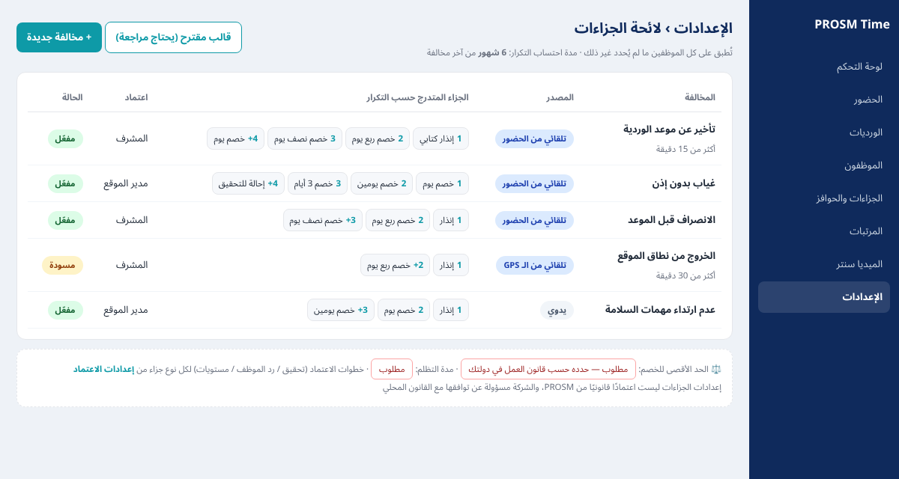
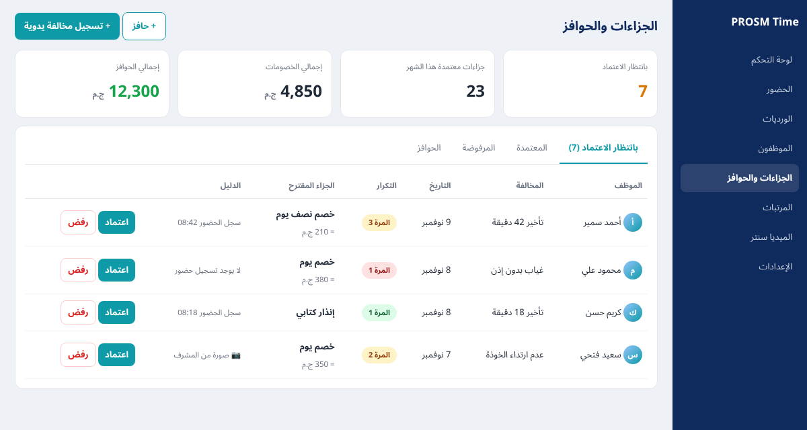
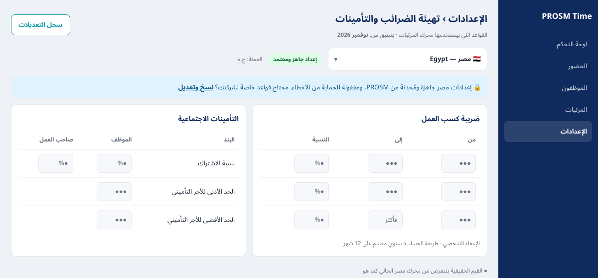
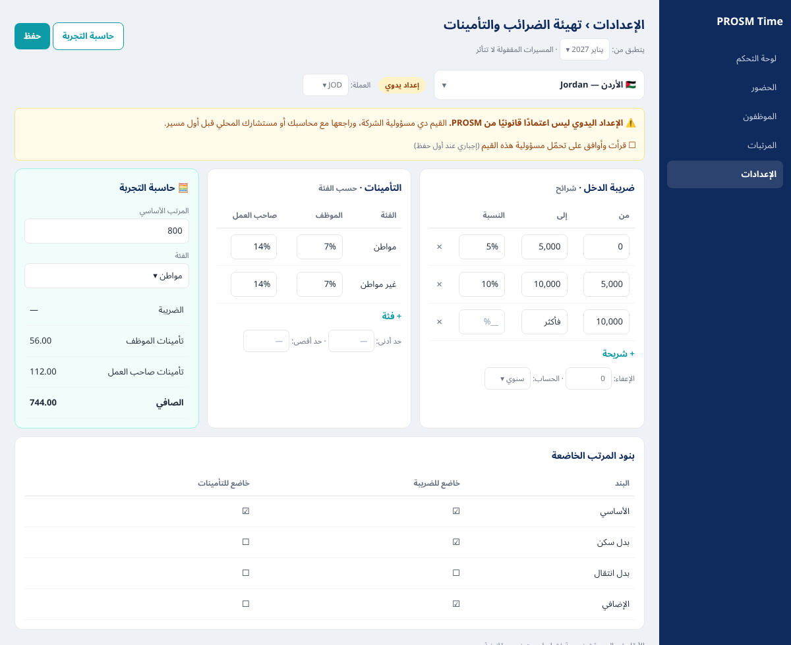

# PROSM Time — مواصفات 4 مميزات جديدة

> **لـ Claude Code:** الملف ده بيوصف 4 مميزات مطلوب إضافتها لـ PROSM Time: إيه هي، وإزاي بتشتغل، وفين مكانها، وشكلها في الواجهة. الصور الموجودة جنب الملف **تصميمات مبدئية للتوضيح** وليست تصميم نهائي، فالتزم بنظام التصميم الموجود في المشروع (الألوان، المكونات، الخطوط، الوضع الداكن/الفاتح، الـ RTL).
> قبل ما تبدأ: افحص الكود الموجود، واستخدم الموجود بدل ما تعمل حاجة جديدة، خصوصًا: **قواعد التأخير والإضافي، وبنود المرتب (الإضافات والخصومات)، والميديا سنتر، والإشعارات، والأدوار والصلاحيات، وسجل الإجراءات (Audit Log)**. أسماء الجداول والحقول هنا اقتراح، ولازم تتكيف مع الـ schema الموجودة.

## نظرة عامة

| # | الميزة | الفكرة في سطر | الباقة المقترحة |
|---|---|---|---|
| 1 | لائحة الجزاءات المتدرجة + الحوافز | المخالفة تتسجل (تلقائي أو يدوي)، النظام يحسب رقم التكرار ويقترح الجزاء من اللائحة، المدير يعتمد، والخصم/الحافز ينزل على المرتب لوحده | Business: السجل والإنذارات · Pro: الربط التلقائي بالمرتب |
| 2 | المستندات وتواريخ انتهائها | كل موظف ليه مستندات مطلوبة بتاريخ انتهاء، والنظام ينبه قبل الانتهاء وعلى الناقص، والموظف يرفع من الموبايل | Business وما فوق |
| 3 | ملف الموظف الكامل | صفحة واحدة لكل موظف فيها كل حاجة عنه في تبويبات | كل الباقات (التبويبات تظهر حسب الباقة) |
| 4 | تهيئة الضرائب والتأمينات | اختيار الدولة: مصر جاهزة ومقفولة (الافتراضي)، وأي دولة تانية المستخدم يدخل قواعدها يدوي | Pro وما فوق |

**ترتيب التنفيذ المقترح:**
1. **الخطوة 0 (قبل أي حاجة تلمس المرتبات):** اختبارات مرجعية لمحرك مصر الحالي. التفاصيل في الميزة 4.
2. الميزة 3: ملف الموظف، لأنه بيجمع باقي المميزات.
3. الميزة 2: المستندات، وبتبقى تبويب جوه ملف الموظف.
4. الميزة 1: الجزاءات.
5. الميزة 4: تهيئة الضرائب والتأمينات.

---

## الميزة 3: ملف الموظف الكامل



### الهدف
النهارده ملف الموظف موجود للمرتبات بس. المطلوب صفحة واحدة تجمع كل حاجة عن الموظف، عشان مدير الـ HR ما يلفّش على 5 شاشات.

### المكان
- **الويب:** القائمة الجانبية ← الموظفون ← الضغط على أي موظف يفتح صفحته.
- **الموبايل (للمدير):** من البحث أو من الخريطة الحية ← الضغط على الموظف.
- **الموبايل (للموظف):** "حسابي" يعرض نسخة للقراءة فقط من ملفه، ويقدر منه يرفع مستنداته.

### التصميم
- **رأس الصفحة (Header):** الصورة الشخصية، والاسم، والوظيفة، والموقع، والكود، وتاريخ التعيين، والحالة (نشط/موقوف/منتهي)، و**شريط اكتمال الملف** (نسبة المستندات الإلزامية المرفوعة).
- **التبويبات:** البيانات · العقد · المستندات · المرتب (ملف المرتبات الموجود حاليًا، يتنقل هنا كما هو) · الحضور · الإجازات · الجزاءات والحوافز · السجل.
- التبويب اللي مش متاح في باقة العميل يظهر **مقفول بعلامة قفل** ومعاه زرار "متاح في Business/Pro"، ولا يختفي (ده بيشجع على الترقية).

### البيانات (إضافات مقترحة)
- **employees:** إضافة الحقول الناقصة لو مش موجودة: `national_id`, `birth_date`, `address`, `phone`, `emergency_contact_name`, `emergency_contact_phone`, `hire_date`, `job_title`, `status`.
- **employee_contracts:** `employee_id`, `type` (محدد المدة/غير محدد/مؤقت), `start_date`, `end_date`, `probation_end_date`, `file_url`.
- **تبويب "السجل":** يقرأ من الـ Audit Log الموجود، مفلتر على الموظف (تغيير مرتب، نقل موقع، جزاء، ترقية...).

### الصلاحيات
- المالك ومدير الـ HR: كل التبويبات.
- مدير الموقع/المشرف: البيانات الأساسية والحضور والإجازات والجزاءات لموظفيه بس. **ما يشوفش المرتب.**
- الموظف نفسه: قراءة فقط + رفع المستندات + التظلم من الجزاءات.

---

## الميزة 2: المستندات وتواريخ انتهائها



### المشكلة اللي بتحلها
عملاؤنا (مطاعم، أمن، مقاولات، مصانع) عندهم مستندات إلزامية ليها تاريخ انتهاء، زي الشهادة الصحية ورخصة القيادة وتصريح العمل والإقامة. لو تفتيش لقى مستند منتهي، الشركة بتدفع غرامة. المطلوب إن النظام يفكّر قبلها، وينبّه على الناقص من أول يوم.

### المكان
1. **تبويب "المستندات"** جوه ملف الموظف (صورة الميزة 3).
2. **شاشة "متابعة المستندات":** الموظفون ← متابعة المستندات. دي شاشة تجمع كل اللي محتاج إجراء في الشركة كلها.
3. **ودجت في لوحة التحكم:** "مستندات تحتاج إجراء: 4 منتهية · 11 قربت" وبيودّي على الشاشة اللي فوق.
4. **الإعدادات ← أنواع المستندات:** المالك يحدد الأنواع المطلوبة.

### الإعداد (مرة واحدة)
المالك يدخل الإعدادات ← أنواع المستندات، ويحدد لكل نوع:
- الاسم
- إلزامي ولا اختياري
- **ينطبق على مين:** كل الموظفين / وظائف معينة (مثلًا رخصة القيادة للسواقين بس) / مواقع معينة
- ليه تاريخ انتهاء ولا لأ
- **يتنبه قبل الانتهاء بكام يوم** (الافتراضي 30 و7 ويوم الانتهاء نفسه)

**قوالب جاهزة حسب الدولة والنشاط** تتعرض عند أول استخدام:
- **مصر:** بطاقة الرقم القومي، الشهادة الصحية، الفيش الجنائي، استمارة 1 تأمينات، شهادة الخدمة العسكرية، عقد العمل، رخصة القيادة
- **الخليج:** الهوية/الإقامة، جواز السفر، تصريح العمل، الشهادة الصحية، رخصة القيادة

### الـ Workflow

```
[الإعداد] المالك يحدد أنواع المستندات المطلوبة
        │
[موظف جديد] النظام يعمل له تلقائيًا قائمة بالمستندات المطلوبة حسب وظيفته وموقعه ← حالتها كلها "ناقص"
        │
[الرفع] الموظف يصوّر المستند من الموبايل  ── أو ──  الـ HR يرفعه من الويب
        │         (يدخل رقم المستند وتاريخ الانتهاء)
        ▼
   حالة المستند: "بانتظار المراجعة"  ← الـ HR يراجع: قبول / رفض مع السبب
        │ قبول
        ▼
   "ساري" ── (Job يومي) ──► قبل الانتهاء بـ 30 يوم: "قرب ينتهي" + إشعار للموظف والـ HR
                              قبل 7 أيام: إشعار تاني
                              يوم الانتهاء: "منتهي" + إشعار للمدير المباشر كمان
        │
[التجديد] الموظف يرفع النسخة الجديدة ← مراجعة ← النسخة القديمة تتحفظ في الأرشيف
```

### الحالات (Status)
`missing` ناقص · `pending_review` بانتظار المراجعة · `valid` ساري · `expiring` قرب ينتهي · `expired` منتهي · `rejected` مرفوض · `not_required` غير مطلوب

### البيانات المقترحة
```
document_types
  id, company_id, name, is_mandatory, has_expiry,
  reminder_days (int[] — default [30, 7, 0]),
  applies_to (all | job_titles[] | site_ids[]), country_template, is_active

employee_documents
  id, employee_id, document_type_id, document_number,
  issue_date, expiry_date, file_url, status,
  uploaded_by, reviewed_by, reviewed_at, rejection_reason,
  replaced_by_id (للأرشيف), created_at
```

### الـ Job اليومي
- بيشتغل مرة كل يوم (مثلًا الساعة 8 الصبح بتوقيت الشركة).
- يحدّث الحالات: `valid` ← `expiring` ← `expired`.
- يبعت الإشعارات حسب `reminder_days`، و**ما يكررش نفس الإشعار في نفس اليوم**.
- يضيف المستندات المنتهية والناقصة على **الملخص الصباحي** (الموجود في Pro).

### الإشعارات
| الحدث | الموظف | الـ HR | المدير المباشر |
|---|---|---|---|
| مستند ناقص (موظف جديد) | ✓ | ✓ | — |
| قرب ينتهي (30/7 أيام) | ✓ | ✓ | — |
| انتهى | ✓ | ✓ | ✓ |
| اترفض بعد المراجعة | ✓ (مع السبب) | — | — |
| الـ HR داس "تذكير الموظف" | ✓ | — | — |

### واجهة الموبايل للموظف
كارت تنبيه في أعلى الشاشة الرئيسية: "الشهادة الصحية تنتهي بعد 13 يوم" ومعاه زرار **📷 تصوير ورفع المستند**. الزرار يفتح الكاميرا مباشرة، وبعد التصوير يطلب تاريخ الانتهاء ويرفع. لازم يشتغل **أوفلاين** ويترفع لما النت يرجع، زي تسجيل الحضور بالظبط.

---

## الميزة 1: لائحة الجزاءات المتدرجة + الحوافز





### الفرق عن اللي موجود النهارده
- **الميديا سنتر** بيخلّينا **ننشر** اللائحة، لكنه ما بيطبقهاش.
- **بنود المرتب** بتخلّينا **نخصم يدوي**، لكن من غير ما نعرف دي المرة الكام، ولا سبب الخصم إيه، ولا نحتفظ بسجل للمخالفات.
- **المطلوب:** النظام **يعدّ التكرار، ويقترح الجزاء المتدرج من اللائحة، ويستنى اعتماد المدير، وبعدها ينزّل الخصم على المرتب، ويحفظ سجل لكل موظف**.

### المكان
- **الإعدادات ← لائحة الجزاءات:** تعريف المخالفات والجزاءات (صورة 01).
- **القائمة الجانبية ← الجزاءات والحوافز:** قسم جديد للمتابعة اليومية والاعتماد (صورة 02).
- **ملف الموظف ← تبويب الجزاءات والحوافز:** سجل الموظف.
- **الموبايل:** المشرف يعتمد ويسجل مخالفة بالصورة، والموظف يشوف الإنذار ويتظلم (صورة 05).

### الإعداد: تعريف المخالفة
| الحقل | مثال |
|---|---|
| اسم المخالفة | تأخير عن موعد الوردية |
| **المصدر** | تلقائي من الحضور / تلقائي من الـ GPS / يدوي |
| الشرط (للتلقائي) | التأخير أكتر من 15 دقيقة |
| **الجزاءات حسب التكرار** | 1: إنذار كتابي · 2: خصم ربع يوم · 3: خصم نص يوم · 4+: خصم يوم |
| **مدة احتساب التكرار** | 6 شهور. لو الموظف ما كررش المخالفة 6 شهور، العداد يرجع لأول مرة |
| **خطوات الاعتماد** | قابلة للضبط لكل نوع جزاء (التفاصيل تحت) |
| اعتماد تلقائي؟ | لأ (افتراضي). ممكن يتفعل للإنذارات بس، لو خطوات الاعتماد تسمح |

**أنواع الجزاء:** قائمة قابلة للضبط على مستوى الشركة. الشركة تقدر تفعّل أو تقفل أي نوع، وتضيف أنواع جديدة حسب قانونها المحلي. الأنواع الأساسية: إنذار شفهي · إنذار كتابي · خصم (أيام / ساعات / مبلغ ثابت) · إيقاف عن العمل · إحالة للتحقيق.

> ⚖️ **مبدأ أساسي:** كل القيود القانونية في الجزاءات (الحد الأقصى للخصم، وأنواع الجزاءات المسموحة، وتسلسلها، وخطوات التحقيق، والمدد) **بتختلف من دولة للتانية**، فهي **إعدادات تحددها الشركة**. **ممنوع وضع أي قيمة قانونية افتراضية في الكود**، ولا تقديم أي رقم على إنه "الحد القانوني".

**قيود عامة على مستوى الشركة (إعداد إجباري قبل تفعيل اللائحة):**
- **الحد الأقصى للخصم:** حقل **إجباري ومن غير قيمة افتراضية**، والشركة تحدد وحدته: أيام في الشهر، أو نسبة من الأجر، أو الاتنين. وجنبه نص: "حسب قانون العمل في دولتك".
- **المدة القصوى لتوقيع الجزاء:** من تاريخ اكتشاف المخالفة، واختيارية.
- **مدة التظلم:** كام يوم يقدر الموظف يتظلم فيها، والشركة تحددها.
- **رسالة مسؤولية:** قبل تفعيل اللائحة لأول مرة تظهر رسالة: "إعدادات الجزاءات ليست اعتمادًا قانونيًا من PROSM، والشركة مسؤولة عن توافقها مع قانون العمل المحلي ومراجعتها مع مستشارها". ومعاها علامة موافقة إجبارية، وتتسجل باسم الشخص والتاريخ.
- **القوالب المقترحة:** زرار "قالب مقترح (يحتاج مراجعة)" فيه **أسماء** مخالفات شائعة وتسلسل كمثال. القالب **ما يتفعلش تلقائيًا**؛ بيتضاف كمسودة، والشركة لازم تراجع كل بند وتفعّله بنفسها. والقالب **ما يحتويش على حد أقصى للخصم**.

**خطوات الاعتماد (قابلة للضبط لكل نوع جزاء):**
اعتماد الجزاء مش مجرد موافقة المدير. لكل نوع جزاء، الشركة تحدد:

| الإعداد | الخيارات |
|---|---|
| تحقيق مكتوب قبل الجزاء | مطلوب / غير مطلوب. لو مطلوب، الجزاء ما يتعتمدش قبل ما يترفع محضر التحقيق |
| إخطار الموظف وسماع رده | مطلوب / غير مطلوب + مدة الرد بالأيام. الجزاء ما يتعتمدش قبل رد الموظف أو انتهاء المدة |
| مستويات الاعتماد | مستوى واحد أو أكتر بالترتيب (مثلًا: المشرف ← الـ HR ← المالك) |
| مين ما ينفعش يعتمد | مثلًا الشخص اللي سجّل المخالفة بنفسه |

مثال: الإنذار الكتابي ممكن يكفيه اعتماد المشرف، أما الإيقاف عن العمل فممكن يحتاج تحقيق مكتوب ورد الموظف واعتماد من الـ HR والمالك. **الأمثلة دي توضيحية، والشركة هي اللي بتحدد.**
- **عند حفظ اللائحة:** يتولد منها PDF ويتنشر تلقائيًا في **الميديا سنتر** مع تأكيد القراءة (ربط بالميزة الموجودة).

### الـ Workflow

```
[مصدر المخالفة]
  ├─ تلقائي: محرك الحضور الموجود رصد تأخير/غياب/انصراف مبكر/خروج من النطاق
  │           (استخدم نفس قواعد التأخير الموجودة في Business، ما تعيدش حسابها)
  └─ يدوي:  مشرف سجّل مخالفة من الموبايل (+ صورة اختياري)
        │
        ▼
[حساب التكرار] عدد مخالفات نفس النوع للموظف خلال "مدة الاحتساب"، والمرفوضة ما تتحسبش
        │
        ▼
[الجزاء المقترح] من سلم اللائحة حسب رقم التكرار ← يتحسب المبلغ من أجر اليوم
        │
        ▼
[خطوات ما قبل الاعتماد] حسب إعداد نوع الجزاء:
   تحقيق مكتوب (لو مطلوب) ← إخطار الموظف وانتظار رده (لو مطلوب)
        │
        ▼
[بانتظار الاعتماد] إشعار للمستوى الأول ← بعده المستوى اللي بعده (لو أكتر من مستوى)
        │
   ┌────┼──────────────┐
 اعتماد  تخفيف (ينزل درجة   رفض (بسبب إجباري،
   │    أو يختار جزاء أقل)  ومش بيتحسب في التكرار)
   ▼
[إشعار للموظف] الإنذار أو الخصم يظهر له في التطبيق ← "اطلعت" أو "تظلم" (خلال مدة التظلم اللي حددتها الشركة)
   │                                           │
   │                              [التظلم] يروح للمستوى الأعلى ← تأكيد أو إلغاء
   ▼
[المرتب] الخصومات المعتمدة تنزل تلقائيًا كبند خصم في دورة المرتب الحالية (Pro)
         مع مراعاة الحد الأقصى اللي حددته الشركة، والزيادة تترحّل للشهر اللي بعده بتنبيه
```

### الحوافز (نفس المحرك، بالعكس)
- **حافز يدوي:** المدير يمنح مبلغ أو نسبة مع السبب.
- **حافز تلقائي بقاعدة:** أمثلة:
  - "صفر تأخير طول الشهر = 300 ج.م"
  - "حضور كامل = يوم إضافي"
- نفس دورة الاعتماد، وبعد الاعتماد ينزل كبند إضافة على المرتب.
- الموظف يوصله إشعار تهنئة (صورة 05، كارت "حافز التزام").

### البيانات المقترحة
```
violation_types
  id, company_id, name, source (attendance_late | attendance_absent |
  attendance_early_leave | geofence_exit | manual), condition_json,
  lookback_days (default 180 — إعداد تشغيلي مش قانوني), auto_approve_warnings, is_active

violation_steps
  id, violation_type_id, occurrence (1,2,3… — آخر خطوة تنطبق على "وما بعدها"),
  action (verbal_warning | written_warning | deduct_days | deduct_hours |
          deduct_amount | suspension | investigation), value

penalty_action_types           -- أنواع الجزاء، قابلة للتفعيل والإضافة لكل شركة
  id, company_id, code, name, kind (warning | deduction | suspension | investigation | other),
  is_active

penalty_approval_policies      -- خطوات الاعتماد لكل نوع جزاء
  id, company_id, penalty_action_type_id,
  requires_written_investigation, requires_employee_response,
  response_window_days, excluded_approver_rule (مثلًا reporter_cannot_approve)

penalty_approval_levels
  id, policy_id, level_order, approver_role

employee_violation_steps       -- تتبع التحقيق والرد ومستويات الاعتماد لكل مخالفة
  id, employee_violation_id, step_type (investigation | employee_response | approval),
  level_order, actor_id, note, attachment_url, completed_at

bylaw_versions                 -- كل حفظ للائحة = إصدار جديد (القديم ما يتمسحش ولا يتعدل)
  id, company_id, version, effective_from, published_by, published_at,
  snapshot_json                -- نسخة كاملة: المخالفات والخطوات وسياسات الاعتماد والحد الأقصى

employee_violations
  id, employee_id, violation_type_id, bylaw_version_id,
  rule_snapshot_json,          -- السلم والجزاء المقترح وسياسة الاعتماد وقت تسجيل المخالفة
  occurred_at, source_ref_id
  (attendance_record_id لو تلقائي), evidence_url, occurrence_number,
  suggested_step_id, final_action, final_value, amount,
  status (pending_investigation | pending_response | pending_approval |
          approved | reduced | rejected | appealed | cancelled),
  decided_by, decided_at, decision_note,
  acknowledged_at, appeal_text, appeal_decided_by, payroll_item_id

incentive_rules / employee_incentives
  نفس الفكرة: rule أو manual ← pending ← approved ← payroll_item_id

company_penalty_settings
  company_id,
  deduction_cap_value (NOT NULL قبل التفعيل — من غير default),
  deduction_cap_unit (days_per_month | percent_of_wage | both),
  deduction_cap_percent (لو both),
  max_days_to_impose (nullable), appeal_window_days (من غير default),
  liability_acknowledged_by, liability_acknowledged_at
```

### قواعد مهمة (Edge Cases)
1. **ما يتسجلش نفس الحدث مرتين:** لو سجل حضور واحد اتعدّل، المخالفة المرتبطة بيه تتحدث أو تتلغي، وما تتعملش مخالفة جديدة (استخدم `source_ref_id`).
2. **الإجازة والإذن المعتمد يلغوا المخالفة:** لو اتعمد إذن تأخير أو إجازة بأثر رجعي، المخالفة التلقائية تتلغي، ولو كانت نزلت على المرتب يتعمل لها تسوية.
3. **المرتب اتقفل:** المخالفة اللي تتعمد بعد قفل الدورة تنزل في الدورة اللي بعدها.
4. **كل تغيير يتسجل في سجل الإجراءات (Audit Log):** مين اعتمد، ومين خفف، ومين رفض، وإمتى.
5. **العمالة الخارجية:** الجزاءات تنطبق عليها لو العميل فعّلها، والخصم يتحسب من أجرهم.
6. **الصلاحيات:** المشرف يشوف ويعتمد لموظفيه بس، وما يقدرش يعتمد مخالفة سجّلها هو بنفسه لو الإعداد مانع ده.
7. **المدة القصوى لتوقيع الجزاء:** لو الشركة حددتها وعدّت، المخالفة تتقفل تلقائيًا كـ "انتهت المدة" ومن غير جزاء.
8. **اللائحة ما تتفعلش** قبل ما الحد الأقصى للخصم ومدة التظلم يتحددوا، وقبل موافقة المسؤولية.
9. **تعديل اللائحة ما بيأثرش بأثر رجعي:**
   - أي تعديل في اللائحة بيعمل **إصدار جديد** (`bylaw_versions`) بتاريخ تطبيق.
   - كل مخالفة بتتربط **بالإصدار اللي كان ساري وقت وقوعها** (`occurred_at`)، وبتحتفظ بنسخة من القاعدة اللي اتطبقت عليها (`rule_snapshot_json`).
   - الجزاء المقترح وخطوات الاعتماد للمخالفات الموجودة **ما يتغيروش** لما اللائحة تتعدل، حتى لو المخالفة لسه بانتظار الاعتماد.
   - **عدّ التكرار** بيكمل على نفس نوع المخالفة عبر الإصدارات (النوع ليه معرّف ثابت)، إلا لو الشركة اختارت "تصفير العداد" وهي بتنشر الإصدار الجديد.
   - شاشة المخالفة بتعرض "طُبقت حسب لائحة الإصدار X بتاريخ Y".

---

## الميزة 4: تهيئة الضرائب والتأمينات




### الهدف
- **مصر:** تفضل زي ما هي بالظبط.
- **أي دولة تانية:** العميل يقدر يشغّل المرتبات فيها من النهارده، بأنه يدخل قواعد دولته بنفسه.

ده بينفّذ الوعد اللي في ملف الأسعار: "الضرائب والتأمينات قابلة للضبط حسب قوانين دولة العميل".

### الخطوة 0: حماية محرك مصر (إلزامية قبل أي تعديل)
1. افهم محرك المرتبات المصري الحالي ووثّقه: المدخلات والمخرجات وطريقة الحساب.
2. اعمل **اختبارات مرجعية (Regression Tests)** بعدد كافي من الحالات: مرتبات صغيرة وكبيرة، وحدود الشرائح، والحد الأدنى والأقصى للأجر التأميني، وتعيين أو خروج في نص الشهر.
3. الاختبارات دي لازم **تنجح قبل وبعد** أي تغيير. **ممنوع تغيير أي نتيجة حساب مصرية.**
4. **مصر ما تتحولش للإعداد اليدوي.** قيمها بتتعرض في الصفحة للقراءة بس، من المحرك الحالي أو من مصدره الحالي.
5. **عرض مصر في الواجهة الجديدة:** اعرض القواعد المصرية السارية حاليًا بأوضح وأسهل شكل يتماشى مع تصميم الصفحة الجديد. **التحسين في العرض بس، والحساب ما يتلمسش.**
   - **ضريبة كسب العمل:** جدول الشرائح كامل، والإعفاء الشخصي، وطريقة الحساب.
   - **التأمينات:** حصة الموظف وحصة صاحب العمل، والحد الأدنى والأقصى للأجر التأميني، والفروع لو المحرك الحالي بيفرّق بينها.
   - **البنود الخاضعة:** أنهي بنود خاضعة للضريبة وأنهي خاضعة للتأمين، حسب المحرك الحالي.
   - **"إزاي بيتحسب؟":** شرح مختصر خطوة بخطوة، من الإجمالي للوعاء للضريبة والتأمينات للصافي، ومعاه **مثال محسوب بالمحرك الحقيقي** من حاسبة التجربة.
   - تاريخ آخر تحديث للقواعد المصرية في النظام.
   - **مصدر القيم المعروضة:** لازم تيجي من نفس المصدر اللي المحرك بيحسب منه، مش نسخة مكتوبة في الواجهة. ولو القيم مكتوبة في الكود دلوقتي، اعمل API للقراءة بس يعرضها **من غير ما تغيّر طريقة الحساب**. وضيف اختبار بيتأكد إن القيم المعروضة = القيم اللي المحرك بيستخدمها.
   - **ممنوع** تعديل أي نسبة أو شريحة أو حد مصري في الخطوة دي، حتى لو شفت إنها محتاجة تحديث. **لو لاحظت أي حاجة، اكتبها في التقرير ليا.**

### المكان
الإعدادات ← الرواتب ← **تهيئة الضرائب والتأمينات**. الصفحة بتظهر للمالك ومدير الـ HR بس.

### طريقة العمل
**أعلى الصفحة: قائمة اختيار الدولة**
- كل دولة بعلمها واسمها بالعربي والإنجليزي، زي `🇯🇴 الأردن — Jordan`، ويكون فيها بحث.
- **الاختيار الافتراضي:**
  - **الشركات الموجودة حاليًا:** مصر 🇪🇬 بالإعداد الجاهز، **من غير أي تغيير في حساباتها**.
  - **الشركات الجديدة:** الافتراضي هو **دولة المؤسسة** اللي اتحددت عند التسجيل. لو مصر، يبقى الإعداد الجاهز. لو أي دولة تانية، يبقى نموذج يدوي فاضي للدولة دي. ولو دولة المؤسسة مش متسجلة، يبقى مصر.
- الكود بيعتمد على كود الدولة ISO (`EG`, `SA`, `JO`...)، **مش على الاسم ولا العلم**.
- اختيار الدولة بيغيّر العملة الافتراضية، والمستخدم يقدر يعدّلها.

**لو اختار مصر (الوضع الافتراضي):**
- الصفحة بتبقى **مليانة بالقيم الحالية ومقفولة**، ومعاها شارة "إعداد جاهز ومعتمد" ورسالة بالقفل.
- زرار **"نسخ وتعديل"**: بينسخ قيم مصر لإعداد يدوي خاص بالشركة دي، ومعاه تأكيد "هتتحمل مسؤولية التعديلات". الإعداد الجاهز نفسه ما بيتغيرش، والشركة تقدر ترجع له في أي وقت.

**لو اختار أي دولة تانية:**
- الصفحة بتفتح **فاضية للتعبئة اليدوية**، ومعاها شارة "إعداد يدوي" وتنبيه ثابت:
  > **الإعداد اليدوي ليس اعتمادًا قانونيًا من PROSM.** القيم دي بتدخلها الشركة على مسؤوليتها، ولازم تراجعها مع محاسبها أو مستشارها المحلي قبل أول مسير.
- **أول حفظ** لأي إعداد يدوي (ومنه "نسخ وتعديل" لمصر) بيطلب **علامة موافقة إجبارية** على النص ده، وتتسجل باسم الشخص والتاريخ. وأي تعديل بعد كده بيعرض التنبيه تاني من غير ما يطلب الموافقة.
- **أي مسير اتحسب بإعداد يدوي** بيظهر عليه شارة "إعداد يدوي" في شاشة المسير وفي تقرير المسير، عشان يبقى واضح بعدين.
- المستخدم بيدخل:

| القسم | المحتوى |
|---|---|
| **ضريبة الدخل** | تشغيل/إيقاف (بعض الدول مفيهاش ضريبة على الرواتب) · **شرائح** (من، إلى، النسبة) بعدد مفتوح · مبلغ معفى · الحساب شهري أو سنوي مقسم على 12 |
| **التأمينات** | تشغيل/إيقاف · **فئات** (مثلًا مواطن / غير مواطن) بعدد مفتوح · لكل فئة: نسبة الموظف ونسبة صاحب العمل · حد أدنى وحد أقصى للأجر التأميني (اختياري) |
| **بنود المرتب الخاضعة** | جدول بكل بنود المرتب الموجودة، ولكل بند: خاضع للضريبة؟ خاضع للتأمينات؟ |
| **يتطبق من** | الشهر اللي القواعد دي تبدأ تتطبق فيه |

- **فئة الموظف** (مواطن / غير مواطن...) بتتحدد في ملف الموظف، تبويب المرتب، وبتظهر بس لو الدولة المختارة فيها فئات.

**حاسبة التجربة:** المستخدم يكتب مرتب افتراضي ويختار الفئة، ويشوف الضريبة والتأمينات والصافي **قبل ما يحفظ**.
- **دالة حساب واحدة على السيرفر:** حاسبة التجربة والمسير الحقيقي **لازم يستدعوا نفس الدالة** (مثلًا `calculatePayslip(input, taxConfigVersion)`). **ممنوع** يبقى في تنفيذين مختلفين، أو حساب مبسط للمعاينة.
- **الفرق الوحيد** إن المعاينة شغالة كـ dry run: بتحسب على **الإعداد اللي لسه ما اتحفظش** (مسودة)، وما بتحفظش أي حاجة ولا بتكتب في المسير.
- ونفس الكلام لمصر: الحاسبة بتستدعي محرك مصر الحالي نفسه.

### الـ Workflow
```
المالك يفتح الصفحة ← مصر مختارة ومقفولة (الافتراضي)
   │
   ├─ يفضل على مصر ← مفيش أي تغيير، والمرتبات شغالة زي ما هي
   │
   ├─ "نسخ وتعديل" لمصر ← نسخة يدوية بقيم مصر ← يعدّل ← حاسبة التجربة ← حفظ بتاريخ تطبيق
   │
   └─ يختار دولة تانية ← نموذج فاضي ← يدخل الشرائح والفئات والبنود
                         ← حاسبة التجربة ← حفظ بتاريخ تطبيق
                                │
                                ▼
         إصدار جديد من القواعد بيتحفظ (القديم ما يتمسحش)
         ← المسيرات اللي هتتعمل من تاريخ التطبيق تستخدم الإصدار الجديد
         ← المسيرات المقفولة ما تتغيرش أبدًا
         ← التعديل يتسجل في سجل الإجراءات
```

### تصميم قابل للتوسع (مهم)
جدول الشرائح والنسب **نواة أولى** وما يكفيش كل الأنظمة الضريبية والتأمينية. **الواجهة في النسخة دي تفضل بسيطة زي الصور**، لكن **الجداول والمحرك لازم يتصمموا بحيث يقبلوا بعدين** الحاجات دي من غير إعادة كتابة:

| القدرة | في النسخة الأولى (الواجهة) | في الجداول والمحرك |
|---|---|---|
| شرائح تصاعدية | ✓ | ✓ |
| **خصومات وإعفاءات متعددة** (مبلغ ثابت أو نسبة، وليها حد أقصى) | إعفاء واحد بس | **قائمة** خصومات/إعفاءات |
| **وعاء الضريبة منفصل عن وعاء التأمين** | علامات خاضع/غير خاضع لكل بند | **تعريف وعاء مستقل** لكل قاعدة |
| **فروع تأمينية** (معاش، إصابات، بطالة...) لكل فئة | نسبة واحدة لكل فئة | **فروع**، ولكل فرع نسبه وحدوده |
| **حدود تأمينية مختلفة** لكل فرع | حد أدنى وأقصى واحد للفئة | حدود على مستوى الفرع |
| **قواعد الموظف وصاحب العمل مستقلة** (نسبة ووعاء وحدود) | نسبتين في نفس الصف | **قاعدتين منفصلتين** (`payer = employee \| employer`) |

> لـ Claude Code: ده **تصميم للتوسع، مش مطلوب تنفيذه في الواجهة دلوقتي**. المطلوب إن الجداول والمحرك ما يقفلوش علينا الطريق. المحرك يحسب من **قائمة قواعد عامة**، مش من أعمدة ثابتة زي `tax_rate`. **ممنوع تخزين كود قابل للتنفيذ في قاعدة البيانات**؛ القواعد بيانات منظمة بشكل محدد والمحرك بيفسرها.

### البيانات المقترحة
```
tax_configs
  id, company_id, country_code (ISO), currency,
  mode (preset | custom),        -- preset = مصر الجاهزة (للقراءة فقط). القيم تقبل التوسع بعدين
  copied_from_preset (bool), effective_from (شهر),
  version, created_by, created_at, is_active,
  liability_acknowledged_by, liability_acknowledged_at   -- إجباري لـ custom

calculation_bases                -- تعريف الوعاء (ضريبة/تأمين/فرع) بشكل مستقل
  id, tax_config_id, code, name
calculation_base_components
  base_id, pay_component_id, included (bool), cap_amount (nullable)

tax_rules
  id, tax_config_id, base_id, enabled,
  calc_period (monthly | annual_div_12)
tax_brackets
  id, tax_rule_id, from_amount, to_amount (null = فأكثر), rate
tax_reliefs                      -- خصومات وإعفاءات (V1: صف واحد بس من الواجهة)
  id, tax_rule_id, name, kind (fixed | percent), value, cap_amount (nullable)

insurance_categories             -- مواطن / غير مواطن...
  id, tax_config_id, name
insurance_branches               -- V1: فرع واحد افتراضي لكل فئة
  id, category_id, name, base_id
insurance_branch_rules           -- قاعدة منفصلة لكل طرف
  id, branch_id, payer (employee | employer), rate,
  min_base (nullable), max_base (nullable)

employees.insurance_category_id  -- يظهر بس لو الدولة فيها فئات

payroll_runs.tax_config_id + tax_config_version + config_mode
  -- ربط كل مسير بالإصدار اللي اتحسب بيه، وإذا كان يدوي
```
**ملحوظة:** في النسخة الأولى، "علامات خاضع للضريبة/للتأمين" في الواجهة بتتحول ورا الكواليس لوعاءين (`calculation_bases`): واحد للضريبة وواحد للتأمين.

### قواعد مهمة
1. **الحساب على السيرفر بس، وبدالة واحدة.** الواجهة بتعرض وبتستقبل المدخلات، وما بتحسبش ضريبة ولا تأمينات. والمعاينة والمسير بيستخدموا نفس الدالة.
2. **ممنوع أي نسبة قانونية ثابتة في الكود** غير مصر الموجودة أصلًا. والكود ما يقترحش أو يملاش نسب لأي دولة تانية من عنده.
3. **أي تعديل = إصدار جديد** بتاريخ تطبيق. ممنوع الكتابة فوق إصدار اتحسب بيه مسير.
4. **المسير المقفول بيحتفظ بنسخة** من القواعد اللي اتحسب بيها.
5. **التحقق من صحة الإدخال:** الشرائح ما تتداخلش ومفيهاش فجوات، والنسب من 0 لـ 100، والحد الأدنى أقل من الحد الأقصى، وفي آخر شريحة "فأكثر".
6. **الصلاحيات:** التعديل للمالك ومدير الـ HR بس، والتحقق منها بيتم على السيرفر.
7. **التنبيه القانوني وموافقة المسؤولية** لازم يتنفذوا ويتسجلوا على السيرفر، مش في الواجهة بس.

### تغيير الدولة لشركة عندها مسيرات
تغيير دولة نظام الرواتب **عملية حساسة**، ولازم تتحكم فيها القواعد دي:
1. **المسيرات المقفولة ما تتأثرش أبدًا:** بتفضل محتفظة بالإعداد والإصدار والدولة اللي اتحسبت بيهم.
2. **التغيير بيتطبق من فترة جاية بس:** أقرب شهر **ما اتفتحلوش مسير**. ممنوع بأثر رجعي.
3. **لو في مسير مفتوح أو مسودة:** التغيير **يتمنع** لحد ما المسير يتقفل أو يتلغي، ومعاه رسالة واضحة.
4. **تأكيد مزدوج:** شاشة بتوضح اللي هيحصل (من إمتى، وكام موظف هيتأثر، وإن المسيرات القديمة ثابتة). وبعدها كتابة اسم الدولة الجديدة للتأكيد. والتغيير ده **للمالك بس**، ويتسجل في سجل الإجراءات.
5. **بيانات الموظفين:** البيانات الخاصة بالدولة القديمة (زي الفئة التأمينية) **ما تتمسحش**؛ بتتأرشف وتفضل مربوطة بالمسيرات القديمة. والموظفين اللي محتاجين فئة في الدولة الجديدة يظهروا في قائمة "بيانات ناقصة" قبل أول مسير.
6. **الرجوع لمصر:** شركة غيّرت لدولة تانية ورجعت لمصر بترجع للإعداد الجاهز، بنفس القواعد دي.

### مؤجل عن قصد (ما يتنفذش دلوقتي، بس التصميم يقبله)
| البند | ليه اتأجل | إمتى نبدأ | المطلوب في التصميم دلوقتي |
|---|---|---|---|
| قواعد جاهزة لدول تانية | كل دولة محتاجة مراجعة قانونية من مختص محلي | لما يبقى في كذا عميل في نفس الدولة | `mode` يقبل قيمة جديدة (مثلًا `verified_preset`) |
| ملفات الصرف الرسمية (WPS في الإمارات، مُدد في السعودية) | محتاجة ربط مع جهات رسمية ومواصفات ملفات معتمدة | أول عميل خليجي بيدفع ويطلب المرتبات | بيانات الموظف والبنك تكون قابلة للتوسع بحقول حسب الدولة |
| مكافأة نهاية الخدمة | قواعدها بتختلف جامد بين الدول وأنواع العقود | مع أول دولة خليجية | المسير يقبل بنود محسوبة جديدة من غير تعديل جوهري |

> **ملحوظة للتسويق مش للكود:** طول ما البنود دي مؤجلة، المرتبات في الخليج تتسوق كـ "حساب مساعد"، مش "متوافق بالكامل".

---

## معايير القبول (Acceptance Criteria)

**ملف الموظف**
- [ ] الضغط على أي موظف يفتح صفحة واحدة فيها كل التبويبات، والتبويبات تظهر أو تتقفل حسب الباقة والصلاحية.
- [ ] شريط اكتمال الملف بيتحسب صح من المستندات الإلزامية.

**المستندات**
- [ ] الموظف الجديد بيتعمل له قائمة مستندات "ناقص" تلقائيًا حسب وظيفته وموقعه.
- [ ] الموظف يقدر يصوّر ويرفع من الموبايل، وده شغال أوفلاين.
- [ ] الـ Job اليومي بيغيّر الحالات ويبعت الإشعارات حسب الأيام المحددة، ومن غير تكرار.
- [ ] شاشة المتابعة والودجت بيعرضوا نفس الأرقام.

**الجزاءات والحوافز**
- [ ] تأخير بيعدّي الشرط ← مخالفة تتعمل تلقائيًا برقم تكرار صح وجزاء مقترح صح.
- [ ] المخالفة المرفوضة ما بتتحسبش في التكرار، والعداد بيرجع لأول مرة بعد مدة الاحتساب.
- [ ] الخصم المعتمد بينزل كبند في المرتب، ومع مراعاة الحد الأقصى اللي حددته الشركة.
- [ ] اللائحة ما بتتفعلش من غير حد أقصى للخصم ومدة تظلم وموافقة المسؤولية، ومفيش أي قيمة قانونية افتراضية في الكود.
- [ ] نوع الجزاء اللي محتاج تحقيق أو رد من الموظف ما بيتعتمدش قبل ما الخطوات دي تخلص، ومستويات الاعتماد بتمشي بالترتيب.
- [ ] القالب المقترح بيتضاف كمسودة، وما بيتفعلش تلقائيًا.
- [ ] تعديل اللائحة بيعمل إصدار جديد، والمخالفات القديمة (حتى اللي بانتظار الاعتماد) محتفظة بالجزاء والسياسة اللي اتسجلت بيهم.
- [ ] الإذن أو الإجازة المعتمدة بأثر رجعي بتلغي المخالفة المرتبطة بيها.
- [ ] الموظف يقدر يقول "اطلعت" أو يتظلم خلال المدة المحددة.
- [ ] كل خطوة متسجلة في سجل الإجراءات.

**تهيئة الضرائب والتأمينات**
- [ ] الاختبارات المرجعية لمصر ناجحة قبل وبعد التنفيذ، ونتائج الحسابات المصرية ما اتغيرتش.
- [ ] الشركات الموجودة مختار لها مصر بالإعداد الجاهز، والقيم ظاهرة ومقفولة.
- [ ] الشركة الجديدة الافتراضي ليها دولة المؤسسة: مصر جاهزة، وأي دولة تانية نموذج فاضي.
- [ ] صفحة مصر بتعرض الشرائح والتأمينات والبنود الخاضعة وشرح "إزاي بيتحسب"، والقيم المعروضة مطابقة للمحرك (باختبار).
- [ ] "نسخ وتعديل" بيعمل نسخة يدوية، والشركة تقدر ترجع للإعداد الجاهز.
- [ ] أي دولة تانية بتفتح فاضية، والمستخدم يقدر يضيف شرائح وفئات من غير حد معين.
- [ ] حاسبة التجربة والمسير بيستدعوا **نفس الدالة** على السيرفر، ونتيجتهم واحدة لنفس المدخلات (باختبار).
- [ ] تغيير الدولة ممنوع مع وجود مسير مفتوح، وبيتطبق من فترة جاية بس، والمسيرات المقفولة وبيانات الموظفين القديمة ما اتأثرتش.
- [ ] التعديل بتاريخ تطبيق مستقبلي ما بيأثرش على المسيرات اللي قبله أو المقفولة.
- [ ] الإدخال الغلط بيترفض برسالة واضحة، زي الشرائح المتداخلة أو النسبة أكبر من 100.
- [ ] الإعداد اليدوي ما بيتحفظش أول مرة من غير موافقة المسؤولية، والموافقة متسجلة على السيرفر.
- [ ] المسير المحسوب بإعداد يدوي عليه شارة "إعداد يدوي" في الشاشة والتقرير.
- [ ] الجداول فيها وعاء مستقل وقائمة إعفاءات وفروع تأمين وقاعدة منفصلة لكل طرف، حتى لو الواجهة بتستخدم أبسط شكل منهم.

**عام**
- [ ] كل الشاشات شغالة بالعربي (RTL) وبالإنجليزي، وفي الوضع الداكن والفاتح، وبالـ 9 لغات الموجودة.
- [ ] مفيش أرقام قانونية ثابتة لأي دولة في الكود (غير محرك مصر الحالي كما هو)؛ كل حاجة قانونية إعداد بتحدده الشركة.
